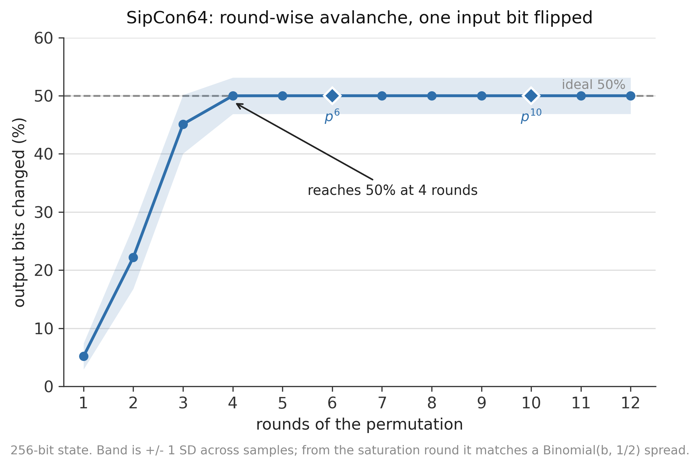
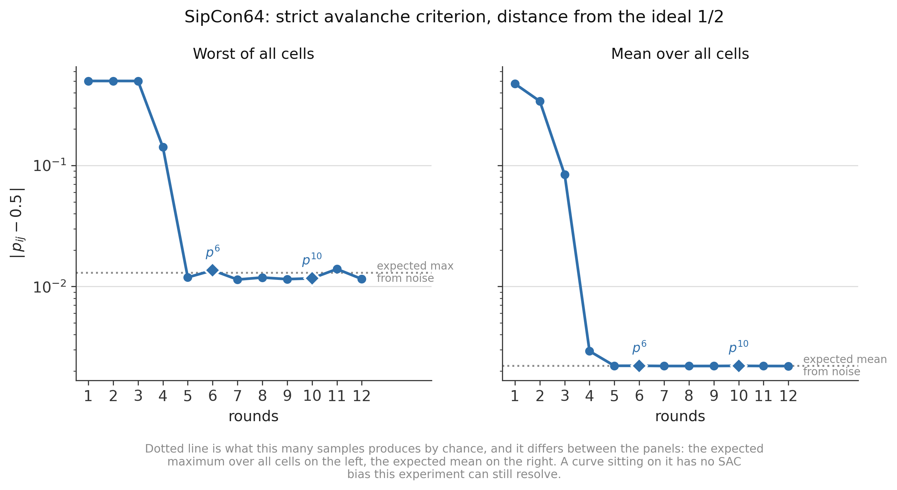
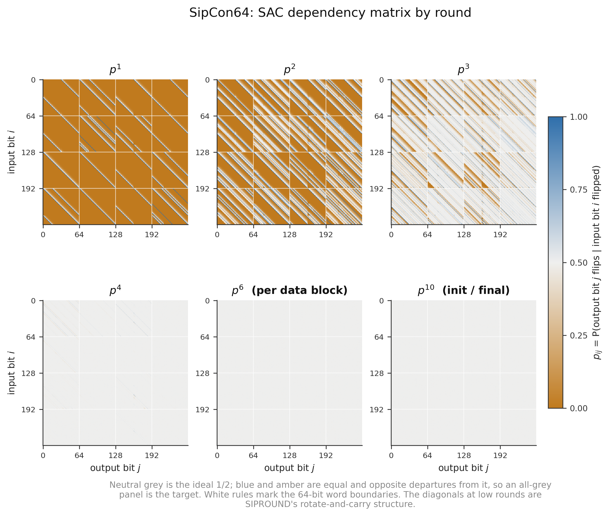
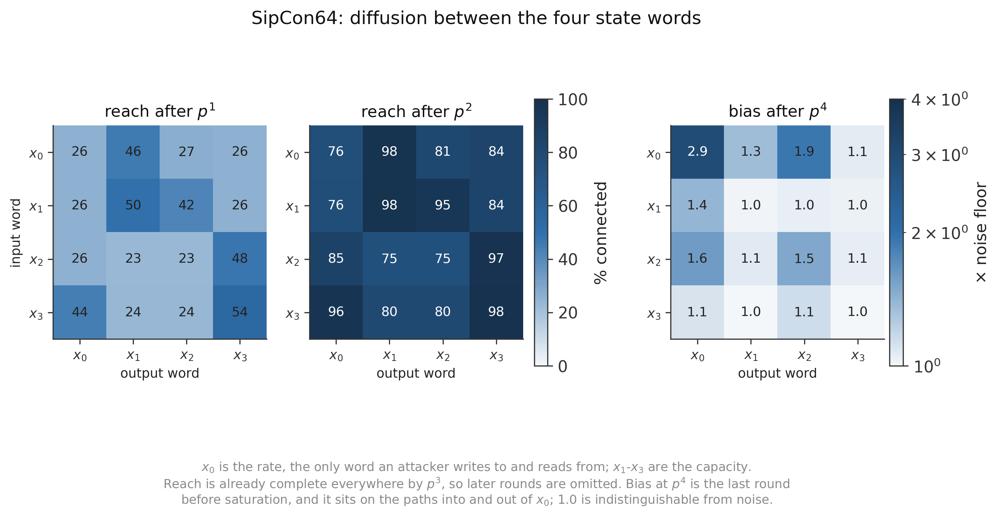
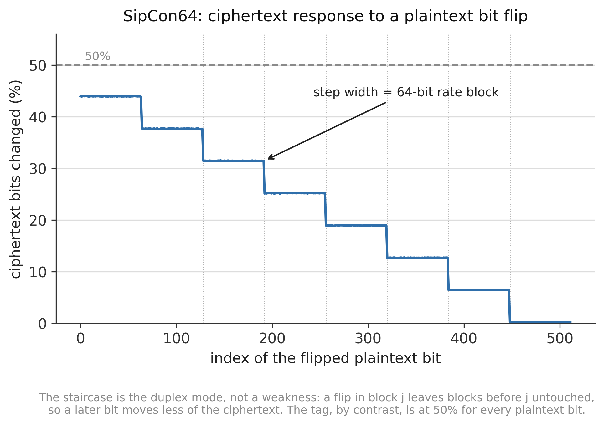
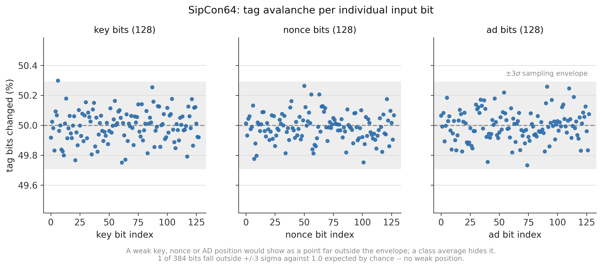
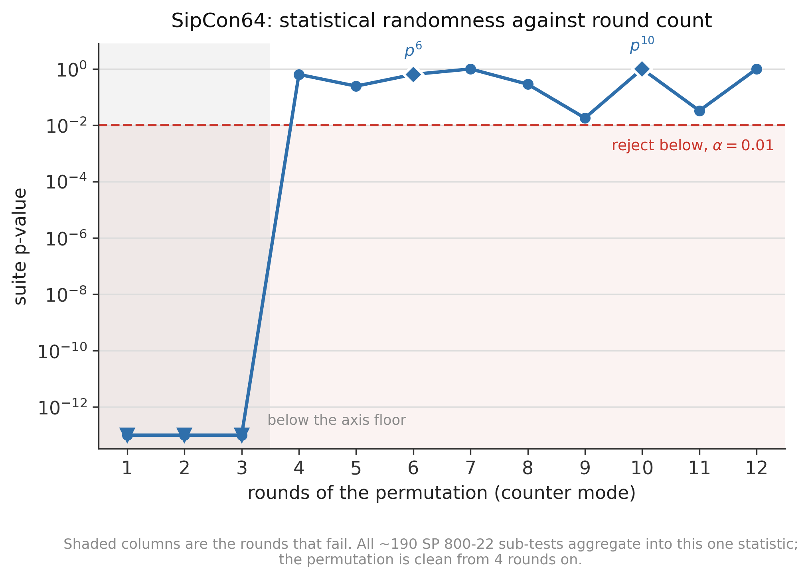

# Security results: SipCon64

Round-wise avalanche and NIST SP 800-22 randomness testing of the SipCon64
hybrid. Method and reproduction: [`README.md`](README.md). Charts:
[`graphs/`](graphs/). Full dataset: [`results/`](results/).

Every measure here is scored against an **absolute** reference — 50% avalanche,
`p_ij` = ½, α = 0.01, or what sampling noise alone produces at this sample size
— so each result stands on its own.

**Read this before the numbers.** None of this is cryptanalysis. Avalanche and
SP 800-22 are *necessary* conditions that every serious cipher meets, including
ones later broken: a construction can show textbook 50% avalanche and pass all
fifteen tests while still falling to differential, linear, cube or algebraic
attacks, none of which these tests look for. What follows establishes that
SipCon64 has no gross statistical defect and locates the round at which its
diffusion saturates. The statement in
[`../sipcon64/README.md`](../sipcon64/README.md) — that the construction has had
**no dedicated cryptanalysis** — is exactly as true after this work as before
it, and `../RESULTS.md` §8.3 caveat 12 is not discharged by anything here.

Measured 2026-10-01 on this machine, seeded (20260929), reproducible with
`./run_all.sh`.

---

## 1. Headline

SipCon64: 256-bit state as four 64-bit words, 64-bit rate (`x0`), 192-bit
capacity (`x1`–`x3`), `p^10` for initialisation and finalisation, `p^6` per
data block.

| measure | result | ideal |
|---|---|---|
| **avalanche reaches 50%** | **4 rounds** | 50% |
| avalanche at `p^6` (per data block) | **50.0016%** | 50% |
| avalanche at `p^10` (init / final) | **49.9995%** | 50% |
| full completeness — every input bit reaches every output bit | 3 rounds | — |
| SAC indistinguishable from ideal (no cell beyond 6σ) | 5 rounds | `p_ij` = ½ |
| **SP 800-22 clean, permutation in counter mode** | **4 rounds** | — |
| **SP 800-22 on the deployed AEAD** (ciphertext, tags, rate word) | **PASS** | — |
| AEAD tag avalanche — key / nonce / AD / plaintext | 49.996 / 49.987 / 49.998 / 50.003% | 50% |
| weak key, nonce or AD bit positions | **none** (1 of 384 outside ±3σ, 1.0 expected) | — |

**SipCon64 passes every test in this directory.** Its permutation hits ideal
avalanche at 4 rounds and holds it exactly through 12; it has no SAC bias this
experiment can resolve from 5 rounds on. At the AEAD level every input class
moves exactly half the tag, with no weak bit position in the key, nonce or
associated data. Its deployed output — ciphertext, tags, and the rate word
alone — passes the full SP 800-22 suite.

**The number that matters for the paper is the margin.** The permutation's
statistics saturate at 5 rounds, and it is deployed with `p^6` between data
blocks — **one round above saturation**. Initialisation and finalisation run
`p^10`, five rounds above. That is the measured cost of the 2026-09-08
reduction from `p^12`/`p^8`. §7 explains why this is a heuristic and not a
security margin.

---

## 2. Round-wise avalanche effect

Flip one input bit of the permutation state, run `p^r`, count output bits that
changed: 32 768 random states × all 256 input bits × 12 rounds = **100.7 M
differential pairs**.

| rounds | bits changed (of 256) | **avalanche average** | SD across samples |
|---:|---:|---:|---:|
| 1 | 13.23 | 5.1668% | 2.239% |
| 2 | 56.79 | 22.1842% | 5.398% |
| 3 | 115.48 | 45.1081% | 5.045% |
| **4** | 127.98 | **49.9904%** | 3.134% |
| 5 | 128.00 | 49.9990% | 3.126% |
| **6** (per data block) | 128.00 | **50.0016%** | 3.125% |
| 7 | 128.00 | 50.0017% | 3.125% |
| 8 | 128.01 | 50.0025% | 3.125% |
| 9 | 127.99 | 49.9980% | 3.124% |
| **10** (init / final) | 128.00 | **49.9995%** | 3.126% |
| 11 | 128.00 | 50.0001% | 3.124% |
| 12 | 128.00 | 49.9996% | 3.125% |

**Avalanche is reached at 4 rounds and is exact from there on.** Across rounds
5–12 the average never departs from 50% by more than 0.0025 percentage points,
which at this sample size is indistinguishable from the ideal.

Two things to take from this beyond the headline number.

**It is not merely centred — it has the right distribution.** From round 4 the
per-sample standard deviation settles at 3.125%, which is exactly `√(b/4)/b`
for b = 256, the spread of a Binomial(256, ½). A permutation could average 50%
while flipping a fixed half of the output bits every time; the variance
matching the binomial ideal to four significant figures rules that out.

**The first round already moves 5.17% of the state.** A single 64-bit modular
addition propagates a carry the width of the word, so SIPROUND spreads
influence immediately rather than deferring it to a separate diffusion layer —
which is the property the round-function substitution was betting on.

### 2.1 The average alone is not enough: strict avalanche criterion

A 50% average is a weak check. The SAC matrix is the sharp version: the
probability `p_ij` that output bit j flips when input bit i flips, over all
65 536 pairs, each of which should be ½.

At 32 768 samples the per-cell sampling noise is σ = 0.00276. Two reference
points follow, and they differ by a factor of 4.7, so both are plotted: the
expected *mean* |deviation| from noise alone is σ√(2/π) = 0.0022, and the
expected *maximum* over 65 536 cells is σ√(2 ln N) = 0.0130.

| rounds | worst cell | mean deviation | cells beyond 6σ | completeness |
|---:|---:|---:|---:|---:|
| 1 | 0.5000 | 0.4736 | 64 020 | 33.4% |
| 2 | 0.5000 | 0.3405 | 57 897 | 86.2% |
| 3 | 0.4999 | 0.0841 | 33 516 | **100%** |
| 4 | 0.1418 | 0.0029 | **955** | 100% |
| **5** | **0.0119** | **0.0022** | **0** | 100% |
| 6 (per block) | 0.0136 | 0.0022 | **0** | 100% |
| 10 (init/final) | 0.0117 | 0.0022 | **0** | 100% |
| 12 | 0.0115 | 0.0022 | **0** | 100% |

**From round 5 there is no SAC bias left to find.** The mean deviation sits on
the noise expectation of 0.0022, the worst cell sits on the expected-maximum
line of 0.0130, and not one of the 65 536 cells exceeds 6σ — a threshold a
perfect permutation crosses about 0.0001 times over a matrix this size.

The instructive round is **4**, where the avalanche average already reads a
flawless 49.990% but 955 cells (1.5% of the matrix) are still measurably
biased, the worst at `p_ij` = 0.642 (input bit 167 → output bit 161) — a 51σ
departure. Reaching every output bit is not the same as reaching it with
probability ½, and the average hides the difference completely. This is the
reason the avalanche curve in §2 should not be read on its own.

The diagonal streaks at `p^1`–`p^3` are SIPROUND's rotate-and-carry structure
written out directly: each addition drags influence up through the carry chain
and each rotation shifts the resulting band. They are gone by `p^4`, where the
faint residue is the 955 cells above.

### 2.2 Where the diffusion actually goes

Avalanche over the whole state is the wrong granularity for a sponge. An
attacker injects data into — and reads ciphertext out of — the **rate word
`x0` alone**; `x1`–`x3` are the 192-bit capacity they never touch directly. So
the operationally interesting question is how influence flows between the four
words.

**Reach.** After one round the pattern is strongly asymmetric and traces
SIPROUND's dataflow: `x0`→`x1` is already 46% connected and `x3`→`x0` 44%,
while `x2`→`x1` and `x2`→`x2` sit at 23%. By two rounds everything is between
75% and 98%, and at three rounds all sixteen word pairs are at 100% — which is
why the figure stops at `p^2` for reach.

**Bias, as a multiple of the noise floor.** This decays 220× → 150× → 40× →
1.5× over the first four rounds (full series in
`results/diffusion_words.csv`); round 4 is the last round before saturation
and the one where the structure shows:

| at `p^4`, bias ÷ noise floor | → `x0` | → `x1` | → `x2` | → `x3` |
|---|---:|---:|---:|---:|
| `x0` → (the **rate**) | **2.9** | 1.3 | 1.9 | 1.1 |
| `x1` → | 1.4 | 1.0 | 1.0 | 1.0 |
| `x2` → | 1.6 | 1.1 | 1.5 | 1.1 |
| `x3` → | 1.1 | 1.0 | 1.1 | 1.0 |

**The residual round-4 bias concentrates on the rate word.** `x0`→`x0` is the
worst block in the state at 2.9× the noise floor, and the concentration is not
subtle: **836 of the 955 biased cells (87.5%) have `x0` as source or
destination**, 362 of them on `x0`→`x0` alone — while cells touching `x0` are
only 43.75% of the matrix. The slowest-equalising path in the permutation is
precisely the one the attacker both writes and reads.

Two qualifications keep this in proportion. It is **entirely gone at `p^5`** —
every word pair back to 1.0× — so neither deployed round count operates
anywhere near it. And `x2` carries the round constant, which is why its
self-path is second-slowest; that is an artefact of the constant injection
point, not of SIPROUND. The finding is worth recording because it says *where*
to point a future reduced-round distinguisher, not because it is a weakness at
the round counts in use.

---

## 3. AEAD-level avalanche

The same experiment one level up, on the full encryption call: 2 048 random
(key, nonce, AD, message) draws, 64-byte message, 16-byte AD, flipping every
bit of each input class in turn — 1.8 M encryptions.

| flipped input | bits | → tag | → ciphertext ‖ tag |
|---|---:|---:|---:|
| key | 128 | 49.996% | 50.002% |
| nonce | 128 | 49.987% | 49.999% |
| associated data | 128 | 49.998% | 50.003% |
| plaintext | 512 | 50.003% | 27.66% ¹ |

¹ Structural, not a defect. In a duplex sponge `C_i = S_r ⊕ P_i`, so flipping a
plaintext bit in block j cannot change any ciphertext block before j — the
state has not absorbed the flip yet. Whole-ciphertext avalanche for a plaintext
flip is below 50% by construction in any duplex mode. The tag is the meaningful
target there, and it is at 50.003%.

The effect is a clean staircase whose step width is exactly the 64-bit rate
block — a direct confirmation that the mode behaves as specified:

### 3.1 No weak key, nonce or AD bit

A class average of 50.00% would hide one bad input position, so every bit is
reported individually.

With 2 048 samples the per-bit standard deviation is 0.098 points.

| class | bits | worst deviation | in σ |
|---|---:|---:|---:|
| key | 128 | 0.299 pp | 3.06σ |
| nonce | 128 | 0.264 pp | 2.71σ |
| associated data | 128 | 0.267 pp | 2.73σ |
| plaintext | 512 | 0.316 pp | 3.23σ |

Across the 384 key, nonce and AD bits, **1 falls outside ±3σ against 1.0
expected by chance**, and over all 896 tested positions the largest departure
is 3.23σ against an expected maximum of about 3.7σ for that many draws. There
is no weak input position at this resolution.

---

## 4. Randomness — NIST SP 800-22

All fifteen tests, expanding to ~190 sub-tests (148 non-overlapping templates,
18 random-excursion-variant states, 8 random-excursion states, 2 serial, 2
cumulative-sums, 11 singletons), at α = 0.01 over 128 independent
1 000 000-bit sequences per stream.

### 4.1 The suite was validated before it was believed

The suite is implemented in this repository (`sts/nist_sts.py`) because NIST's
`assess` binary is not packaged for this machine, and a from-scratch
implementation is worth nothing until it is shown to work.
`sts/validate_sts.py` runs it on streams whose verdict is known in advance:

| control stream | expected | sub-tests failed | verdict |
|---|---|---:|---|
| `os.urandom` | PASS | 4 / 188 (1.1 expected) | **PASS** ✓ |
| all-zero bytes | FAIL | 162 / 162 | **FAIL** ✓ |
| 64-bit counter | FAIL | 161 / 162 | **FAIL** ✓ |
| LCG low byte | FAIL | 188 / 188 | **FAIL** ✓ |
| **SipCon64 `p^1`, counter mode** | FAIL | 161 / 162 | **FAIL** ✓ |

with the mean pass proportion on `urandom` at 0.9883 against the expected 0.99.
The last row is the domain-specific control: it confirms the suite can detect
an under-mixed SipCon64, which is what the round sweep in §4.3 depends on.
(The controls are drawn fresh each run, so the `urandom` failure count varies
between runs; the verdict does not.)

### 4.2 The deployed construction

| stream | sub-tests | failed | expected by chance | suite p | verdict |
|---|---:|---:|---:|---:|---|
| ciphertext stream (full AEAD) | 188 | 3 | 1.78 | 0.264 | **PASS** |
| tags (full AEAD) | 188 | 1 | 1.73 | 0.823 | **PASS** |
| `p^10` permutation, counter mode | 188 | 0 | 1.67 | 1.000 | **PASS** |
| `p^6` permutation, counter mode | 188 | 2 | 1.82 | 0.543 | **PASS** |
| `p^6`, rate word only | 188 | 3 | 1.71 | 0.245 | **PASS** |

**The "failed" column is not a defect count.** With ~190 sub-tests at α = 0.01
a perfect generator is expected to fail about 1.8 of them, which is why the
expected count and the suite p-value sit beside it. Every individual failure
here is a non-overlapping-template or random-excursion sub-test missing the
proportion band by one sequence out of 128, each with a healthy uniformity
p-value — the signature of chance, not of structure.

Three of these rows are worth separating:

- **Tags pass independently of the ciphertext.** The tag comes out of the
  finalisation permutation and the key XOR, not the rate, so it exercises a
  different output path — and it is the path a forger attacks.
- **`p^6` passes on its own**, which matters because it is the per-block count
  and the one the 2026-09-08 reduction changed.
- **The rate-only stream passes.** In the real mode the capacity is never
  output, so taking only `x0` is the honest version of what an attacker
  observes per permutation call. Testing the whole 256-bit state would be
  easier and less meaningful.

### 4.3 Randomness against round count

The round count is the parameter the reduction changed, so it is swept from 1
to 12 on the bare permutation in counter mode — all-zero capacity, low-weight
counter input, a deliberately hard case (32 sequences per point).

| rounds | failed | suite p | verdict |
|---:|---:|---:|---|
| 1 | 161 / 162 | ≈ 0 | **FAIL** |
| 2 | 161 / 162 | ≈ 0 | **FAIL** |
| 3 | 141 / 188 | 1.2 × 10⁻¹⁹⁰ | **FAIL** |
| **4** | 1 / 188 | 0.641 | **PASS** |
| 5 | 2 | 0.246 | PASS |
| **6** (per block) | 1 | 0.641 | **PASS** |
| 7 | 0 | 1.000 | PASS |
| 8 | 2 | 0.287 | PASS |
| 9 | 4 | 0.018 | PASS |
| **10** (init/final) | 0 | 1.000 | **PASS** |
| 11 | 4 | 0.033 | PASS |
| 12 | 0 | 1.000 | PASS |

**The transition is sharp: catastrophic failure at 3 rounds, clean at 4.** At
`p^3` the failures are broad — runs, serial, overlapping template and 137 of
the 148 non-overlapping templates — consistent with the SAC picture at that
round (33 516 cells still beyond 6σ). One round later nothing survives.

Above the threshold the failure count wanders between 0 and 4 with no trend
(its correlation with the round count is +0.115), which is sampling noise and
not a quality gradient — so the figure plots the decision statistic rather
than the count. The two lowest points (r = 9 at p = 0.018,
r = 11 at p = 0.033) are unremarkable across 12 streams — under the null
hypothesis p-values are uniform, so values near 0.02 are expected to turn up —
and neither is near the threshold the verdict depends on.

---

## 5. Summary of the two requested analyses

| | result |
|---|---|
| **1. Round-wise avalanche effect average** | Reaches the ideal 50% at **4 rounds** and holds it to within 0.0025 pp through round 12. At the deployed counts: **50.0016% at `p^6`**, **49.9995% at `p^10`**. The spread also matches Binomial(256, ½) exactly, so the distribution is right and not just the mean. SAC confirms it at the cell level from round 5. |
| **2. Randomness test (NIST SP 800-22)** | **PASS** on all five deployed streams — ciphertext, tags, `p^10`, `p^6`, and the rate word alone — with failure counts at or below what chance predicts. The bare permutation becomes statistically clean at **4 rounds**, against the 6 and 10 the construction uses. |

---

## 6. Caveats

1. **The round-constant schedule is part of the measurement.** `p^r` uses the
   tail of the 12-entry schedule, `RC[12-r..11]`, as the construction does.
   Constants do not cancel out of a differential — SIPROUND's additions are
   modular and non-linear, so the output difference depends on actual state
   values. A different schedule would shift the low-round numbers slightly.
2. **Counter-mode streams are one input shape.** The sweep uses an all-zero
   capacity and a low-weight counter. It is a hard case, not the only one; a
   different input family could place the threshold differently.
3. **The round sweep uses 32 sequences, not 128**, because its job is to
   locate a threshold rather than certify a stream, so its individual p-values
   are noisier (§4.3). The threshold itself does not depend on the noisy points.
4. **SAC resolution is bounded by sample count.** At 32 768 samples nothing
   below a deviation of about 0.013 is measurable, so "no bias at `p^5`" means
   none this experiment can resolve, not none at all.
5. **Random-excursion tests do not run on every sequence.** They require at
   least 500 zero-crossing cycles, which a 1 000 000-bit random walk meets
   roughly half the time, so those sub-tests aggregate fewer than 128
   sequences. `results/sts_detail.csv` records the count per sub-test.
6. **The SP 800-22 suite is a from-scratch implementation**, validated as in
   §4.1 but not cross-checked against NIST's `assess`, which is unavailable
   here. The validation is strong evidence of correctness; it is not the same
   as matching the reference implementation vector-for-vector.
7. **This measures the reference C**, the same code `../SOFTWARE-RESULTS.md`
   profiles. The Verilog in `../verilog/` was not re-tested here, and
   `../RESULTS.md` §1.1 still records the hybrid's RTL as the least-verified
   design in that file.

---

## 7. What these results do and do not support

**Supported.** SipCon64 reaches ideal avalanche with a binomial distribution in
4 rounds, is complete in 3, and has no resolvable SAC bias from 5. Its AEAD
call responds to every key, nonce, AD and plaintext bit at exactly 50% of the
tag with no weak position. Its deployed output passes the full SP 800-22 suite,
from a suite validated to reject four known-weak streams including a 1-round
version of the cipher itself. The construction has no gross statistical defect.

**Not supported — the important half.**

1. **These tests bound no attack.** Statistical saturation at 5 rounds says
   nothing about how far a differential or linear distinguisher reaches; for
   permutations of this kind published distinguishers routinely go well past
   the round at which avalanche saturates. The "one round of headroom" figure
   is a descriptive statistic, **not** a security margin.
2. **Passing is the floor, not evidence of strength.** Every cipher that has
   ever been broken also passed tests like these. A pass removes a way to be
   obviously wrong; it supplies no positive security argument.
3. **`p^6` has one round of headroom over saturation.** This is the one
   measured result that argues against the 2026-09-08 reduction, and it is weak
   in isolation for reason 1 — but it is the direction a reviewer will press
   on, and the paper should state it rather than wait to be asked.
4. **The round function's pedigree does not transfer.** SIPROUND is
   well-studied as the core of a short-input PRF, not as a sponge permutation
   with an attacker-controlled rate and a 12-round constant schedule bolted on.
   Its record in SipHash is not a result about SipCon64.
5. **Nothing here addresses** side channels, fault attacks, nonce misuse,
   related-key settings, or state recovery against the 64-bit rate in the
   multi-user setting.

**What would move the needle**, in order of value per effort:

- a **differential/linear bound** over the SIPROUND-based round via MILP or
  SAT — the standard first result for a new permutation, and the natural
  companion to the HAxSH work `../paper/related-work.tex` already cites;
- a **cube / division-property** distinguisher search against reduced-round
  initialisation, aimed at the `x0`-centred paths §2.2 identifies as slowest;
- **regenerating the known-answer vectors** against the current `p^10`/`p^6`
  reference, which `../RESULTS.md` §8.3 caveat 11 still lists as outstanding
  and which is far cheaper than either of the above.

---

## 8. Provenance

| what | how |
|---|---|
| permutation & AEAD under test | [`../sipcon64/sipcon64.c`](../sipcon64/sipcon64.c), linked in and called directly — not re-implemented |
| reference pinned by | `src/selftest.c`, frozen `p^12` and AEAD vectors (15 checks, `results/selftest.txt`) |
| avalanche / SAC / word diffusion | `src/avalanche.c`, 32 768 samples, seed 20260929 |
| AEAD avalanche | `src/avalanche.c`, 2 048 samples, seed 20260929 |
| bitstreams | `src/gen_streams.c`, 4 modes, seed 20260929 |
| SP 800-22 | `sts/nist_sts.py`, validated by `sts/validate_sts.py` (`results/sts_validation.txt`) |
| figures | `make_graphs.py`; palette checked by `validate_palette.py` |

**Tools:** GCC 13.3.0 (`-O3 -march=native -fopenmp`), Python 3.12.4, numpy
2.0.2, scipy 1.14.1. Machine: Intel Core i7-6700, 8 threads — the same host as
`../SOFTWARE-RESULTS.md`.

Reproduce with `./run_all.sh` (~12 min). Every stream is regenerated from seed
20260929, so `streams/` is not version-controlled; `results/` and `graphs/`
are. Results are deterministic and independent of thread count.
